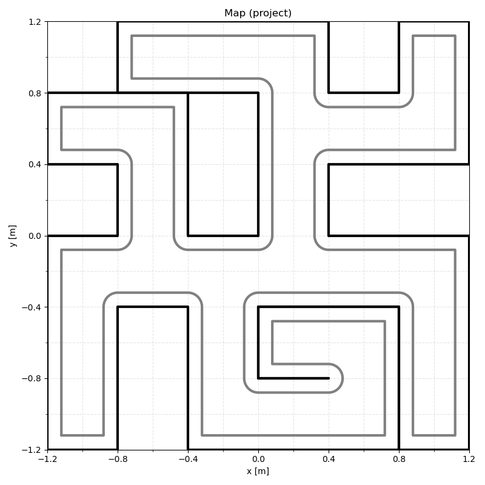

# RMA Lab: Autonomous Mobile Robot

ROS 2 Humble stack for a TurtleBot3 Burger. The robot starts at an unknown pose in a known map, localizes itself with a LiDAR particle filter, plans a path to a goal and drives there. It runs in CoppeliaSim and on the real robot.

Team project for the Autonomous Mobile Robots (RMA) course at ICAI, Universidad Pontificia Comillas. The base package layout, maps and simulation scenes were provided by the course.



## How it works

```
/scan, /odometry --> particle filter --> /pose --> wall follower --> /cmd_vel   (while not localized)
                           |                 |
                       allow_move            +--> PRM + A* --> /path --> pure pursuit --> /cmd_vel   (once localized)
```

1. The wall follower explores the map while the robot does not know where it is.
2. The particle filter performs global localization. It spreads 3000 particles over the whole map, weights them with a LiDAR measurement model and uses DBSCAN clustering to decide when they have converged to a single pose. If the measurement likelihood stays low for several updates it resets the particles. During each sensor update it publishes `allow_move` to stop the robot.
3. Once the robot is localized, the planner samples a probabilistic roadmap (PRM) over the free space, finds the shortest path with A* and smooths it.
4. Pure pursuit follows the smoothed path until the goal is reached.

A lifecycle manager configures and activates every node in order.

### C++ particle filter

The particle filter was first written in Python (`amr_localization`) and then ported to C++ for speed (`amr_localization_cpp`). The core of the filter (motion model, ray casting against the map, resampling and clustering) is written in C++ with Eigen and exposed to the ROS 2 node through a [nanobind](https://github.com/wjakob/nanobind) module called `_pf_core`. The final launch file uses this version.

The Python package also includes an EKF for pose tracking. It works, but it is disabled in the final launch file.

## Repository layout

| Folder    | Target                                                     |
| --------- | ---------------------------------------------------------- |
| `sim_ws/` | Simulation in CoppeliaSim (includes a VS Code devcontainer) |
| `tb3_ws/` | Real TurtleBot3 Burger                                      |

Both workspaces share the same packages. `tb3_ws` adds the hardware nodes and uses parameters tuned on the real robot, such as sensor noise, roadmap density and lookahead distance.

| Package                | Contents                                                              |
| ---------------------- | --------------------------------------------------------------------- |
| `amr_bringup`          | Launch files (`lab02` to `lab04`, `project`) and lifecycle manager     |
| `amr_control`          | Wall follower and pure pursuit                                         |
| `amr_localization`     | Particle filter and EKF in Python                                      |
| `amr_localization_cpp` | Particle filter with a C++ core (nanobind and Eigen)                   |
| `amr_planning`         | PRM roadmap, A* search and path smoothing                              |
| `amr_msgs`             | Custom messages: `PoseStamped` (pose and `localized` flag), `AllowMove` |
| `amr_simulation`       | CoppeliaSim bridge and scenes (`sim_ws` only)                          |
| `amr_turtlebot3`       | Odometry and goal monitoring for the real robot (`tb3_ws` only)       |

## Requirements

1. Ubuntu 22.04 with ROS 2 Humble.
2. CoppeliaSim with the ZMQ remote API, only for simulation.
3. The Python packages listed in [`sim_ws/.devcontainer/requirements.txt`](sim_ws/.devcontainer/requirements.txt).
4. Eigen3 (`libeigen3-dev`) and nanobind (`pip install nanobind`) to build the C++ particle filter.

The simplest setup is the devcontainer in `sim_ws/.devcontainer`. Open `sim_ws` in VS Code and choose "Reopen in Container". It provides a desktop over RDP on port 3389. It does not install nanobind, so install it inside the container before building.

## Run in simulation

Open `sim_ws/src/amr_simulation/worlds/project.ttt` in CoppeliaSim. The bridge connects to it on port 23000 (through `host.docker.internal` when running from the devcontainer). Then build and launch:

```bash
cd sim_ws
colcon build --symlink-install
source install/setup.bash
ros2 launch amr_bringup project.launch.py
```

The start pose and the goal are defined at the top of `amr_bringup/launch/project.launch.py`.

## Run on the real robot

Start the TurtleBot3 drivers on the robot (LiDAR and wheel encoders) and make sure the robot and your computer are on the same ROS 2 network. Then build and launch on your computer:

```bash
cd tb3_ws
colcon build --symlink-install
source install/setup.bash
ros2 launch amr_bringup project.launch.py
```

## Labs

The branches `feature/p2`, `feature/p3` and `feature/p4` contain the earlier lab assignments: wall following, particle filter localization, and EKF tracking with PRM planning and pure pursuit. They were later combined into the final project.
